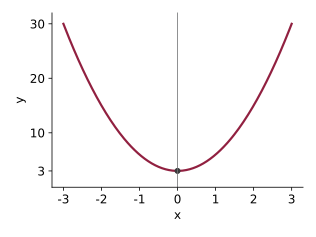
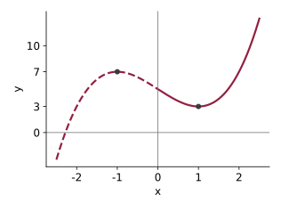
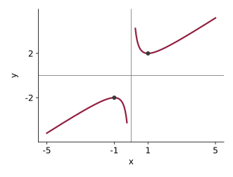

Problem numbers refer to the textbook (Chiang & Wainwright, 4th edition). These are not graded, but you should attempt them all before the quiz. Try each question yourself first, then expand the **Solution** to check.

## Exercise 9.2

**1.** Find the stationary values of the following (check whether they are relative maxima or minima or inflection points), assuming the domain to be the set of all real numbers:

c. $y = 3x^{2} + 3$

Solution

$$\frac{dy}{dx} = 6x = 0 \;\Rightarrow\; x^{*} = 0$$

In the immediate neighborhood of $0$, $dy/dx < 0$ for $x < 0$ and $dy/dx > 0$ for $x > 0$. The slope changes sign from negative to positive, so the function is decreasing to the left of $0$ and increasing to the right: $f(0) = 3$ is a relative minimum. The second derivative confirms this: $d^{2}y/dx^{2} = 6 > 0$.

{fig-alt="The upward-opening parabola y equals 3 x squared plus 3, symmetric about the vertical axis, with a dot at its lowest point (0, 3)" width=380}

**2.** Find the stationary values of the following (check whether they are relative maxima or minima or inflection points), assuming the domain to be the interval $[0, \infty)$:

a. $y = x^{3} - 3x + 5$

Solution

$$\frac{dy}{dx} = 3x^{2} - 3 = 0 \;\Rightarrow\; x^{*} = \pm 1$$

The derivative $3(x^{2} - 1)$ is negative on the immediate left of $1$ (for example at $0.9$) and positive on the immediate right (at $1.1$), so there is a relative minimum at $x = 1$. It is positive on the immediate left of $-1$ and negative on the right, so there would be a relative maximum at $x = -1$. But the domain is $[0, \infty)$, so $-1$ is not admissible. The only stationary value is the relative minimum $f(1) = 3$.

The second-derivative test gives the same answer: $d^{2}y/dx^{2} = 6x$, which is $6 > 0$ at $x = 1$.

{fig-alt="The curve y equals x cubed minus 3 x plus 5, drawn solid for x at least 0 and dashed for negative x. Dots mark the local minimum at (1, 3) on the solid part and the local maximum at (negative 1, 7) on the dashed part" width=380}

**3.** Show that the function $y = x + 1/x$ (with $x \neq 0$) has two relative extrema, one a maximum and the other a minimum. Is the "minimum" larger or smaller than the "maximum"? How is this paradoxical result possible?

Solution

$$f'(x) = 1 - \frac{1}{x^{2}} = 0 \;\Rightarrow\; x^{*} = \pm 1$$

The derivative, $(x^{2} - 1)/x^{2}$, is negative on the immediate left of $1$ and positive on the immediate right, so $f(1) = 2$ is a relative minimum. It is positive on the immediate left of $-1$ and negative on the right, so $f(-1) = -2$ is a relative maximum.

The relative maximum, $-2$, is lower than the relative minimum, $2$. This is not a contradiction: these are *relative* extrema, each compared only with nearby points on its own branch of the graph. The function is not defined at $x = 0$, and the two branches never meet.

{fig-alt="The two branches of y equals x plus 1 over x. The right branch, for positive x, has a dot at its lowest point (1, 2); the left branch, for negative x, has a dot at its highest point (negative 1, negative 2), which lies below the minimum of the right branch" width=400}

**4.** Let $T = \phi(x)$ be a total function (e.g., total product or total cost):

a. Write out the expressions for the marginal function $M$ and the average function $A$.

Solution

$$M = \phi'(x), \qquad A = \frac{\phi(x)}{x}$$

b. Show that, when $A$ reaches a relative extremum, $M$ and $A$ must have the same value.

Solution

At an extremum of $A$,
$$A' = \frac{\phi'(x)\, x - \phi(x)}{x^{2}} = 0 \;\Rightarrow\; \phi'(x^{*}) = \frac{\phi(x^{*})}{x^{*}}$$
that is, $M = A$.

c. What general principle does this suggest for the drawing of a marginal curve and an average curve in the same diagram?

Solution

The marginal curve must cross the average curve at the point where the average curve reaches its extremum (its lowest point for a U-shaped average cost curve).

d. What can you conclude about the elasticity of the total function $T$ at the point where $A$ reaches an extreme value?

Solution

$$\varepsilon = \frac{\phi'(x)\, x}{\phi(x)} = \frac{M}{A}$$
When $M = A$, the elasticity equals $1$.

