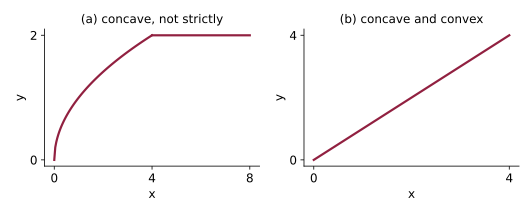
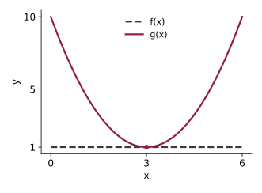

Problem numbers refer to the textbook (Chiang & Wainwright, 4th edition). These are not graded, but you should attempt them all before the quiz. Try each question yourself first, then expand the **Solution** to check.

## Exercise 9.3

**2.** Which of the following quadratic functions are strictly convex?

a. $y = 9x^{2} - 4x + 8$

Solution

$y' = 18x - 4$ and $y'' = 18 > 0$ for all $x$: strictly convex.

b. $w = -3x^{2} + 39$

Solution

$w' = -6x$ and $w'' = -6 < 0$: strictly concave, not convex.

c. $u = 9 - 2x^{2}$

Solution

$u' = -4x$ and $u'' = -4 < 0$: strictly concave, not convex.

d. $v = 8 - 5x + x^{2}$

Solution

$v' = -5 + 2x$ and $v'' = 2 > 0$: strictly convex.

**3.** Draw (a) a concave curve which is not strictly concave, and (b) a curve which qualifies simultaneously as a concave curve and a convex curve.

Solution

(a) Any concave curve that contains a straight segment, for example $y = \sqrt{x}$ for $0 \leq x \leq 4$ continued as the horizontal line $y = 2$ for $x > 4$. (b) A straight line, for example $y = x$: its second derivative is zero everywhere, so it satisfies both $f'' \leq 0$ and $f'' \geq 0$.

{fig-alt="Two panels. Panel a: a curve that rises like a square root and then continues as a flat horizontal line, so it is concave but contains a straight segment. Panel b: a straight line through the origin with slope 1, which is both concave and convex" width=600}

**4.** Given the function $y = a - \dfrac{b}{c + x}$ $(a, b, c > 0;\; x \geq 0)$, determine the general shape of its graph by examining (a) its first and second derivatives, (b) its vertical intercept, and (c) the limit of $y$ as $x$ tends to infinity. If this function is to be used as a consumption function, how should the parameters be restricted in order to make it economically sensible?

Solution

(a) $\dfrac{dy}{dx} = \dfrac{b}{(c + x)^{2}} > 0$ and $\dfrac{d^{2}y}{dx^{2}} = -\dfrac{2b}{(c + x)^{3}} < 0$, so the function is increasing and strictly concave.

(b) At $x = 0$, $y = a - b/c$.

(c) As $x \to \infty$, $b/(c + x) \to 0$, so $y \to a$. The graph rises from $a - b/c$ toward the horizontal asymptote $y = a$, flattening as it goes.

As a consumption function with income $x$: consumption should be positive at zero income, which requires $ac > b$, and the marginal propensity to consume $dy/dx$ should be less than $1$ at every income level, which requires $b/c^{2} < 1$, that is, $b < c^{2}$.

**5.** Draw the graph of a function $f(x)$ such that $f'(x) \equiv 0$, and the graph of a function $g(x)$ such that $g'(3) = 0$. Summarize in one sentence the essential difference between $f(x)$ and $g(x)$ in terms of the concept of stationary point.

Solution

$f(x)$ must be a constant, say $f(x) = 1$; every point is a stationary point. $g(x)$ could be $g(x) = x^{2} - 6x + 10$, which has a single stationary point at $x = 3$. The difference: $f$ is stationary everywhere, whereas $g$ is stationary only at $x = 3$.

{fig-alt="A dashed horizontal line f of x equals 1 and a maroon parabola g of x with its minimum at (3, 1), marked by a dot, touching the line there" width=400}

## Exercise 9.4

**1.** Find the relative maxima and minima of $y$ by the second-derivative test:

b. $y = x^{3} + 6x^{2} + 9$

Solution

$$\begin{aligned}
y' &= 3x^{2} + 12x = 3x(x + 4) = 0 \;\Rightarrow\; x^{*} = 0, -4 \\
y'' &= 6x + 12
\end{aligned}$$

$y''(0) = 12 > 0$, so $y(0) = 9$ is a relative minimum. $y''(-4) = -12 < 0$, so $y(-4) = 41$ is a relative maximum.

d. $y = \dfrac{2x}{1 - 2x} \quad \left(x \neq \tfrac{1}{2}\right)$

Solution

By the quotient rule,
$$y' = \frac{2(1 - 2x) - 2x(-2)}{(1 - 2x)^{2}} = \frac{2}{(1 - 2x)^{2}}$$
which is never zero. There is no stationary point, so there are no relative extrema. The function is increasing on each side of $x = 1/2$.

**2.** Mr. Greenthumb wishes to mark out a rectangular flower bed, using a wall of his house as one side of the rectangle. The other three sides are to be marked by wire netting, of which he has only 64 ft available. What are the length $L$ and width $W$ of the rectangle that would give him the largest possible planting area? How do you make sure that your answer gives the largest, not the smallest area?

Solution

Let $L$ be the side parallel to the wall and $W$ the two sides perpendicular to it. The netting constraint is $L + 2W = 64$, so $L = 64 - 2W$ and the area is
$$A = LW = (64 - 2W)W = 64W - 2W^{2}$$
$$\frac{dA}{dW} = 64 - 4W = 0 \;\Rightarrow\; W^{*} = 16, \quad L^{*} = 32$$
Since $d^{2}A/dW^{2} = -4 < 0$, this is a maximum (the area function is strictly concave, so it is the global maximum). The largest area is $32 \times 16 = 512$ square feet.

**3.** A firm has the following total-cost and demand functions:
$$C = \tfrac{1}{3}Q^{3} - 7Q^{2} + 111Q + 50, \qquad Q = 100 - P$$

a. Does the total-cost function satisfy the coefficient restrictions of (9.5)? ($a, c, d > 0$, $b < 0$, $b^{2} < 3ac$)

Solution

Yes: $a = 1/3 > 0$, $b = -7 < 0$, $c = 111 > 0$, $d = 50 > 0$, and $b^{2} = 49 < 3ac = 111$.

b. Write out the total-revenue function $R$ in terms of $Q$.

Solution

From the demand function, $P = 100 - Q$, so
$$R = PQ = (100 - Q)Q = 100Q - Q^{2}$$

c. Formulate the total-profit function $\pi$ in terms of $Q$.

Solution

$$\pi = R - C = 100Q - Q^{2} - \tfrac{1}{3}Q^{3} + 7Q^{2} - 111Q - 50 = -\tfrac{1}{3}Q^{3} + 6Q^{2} - 11Q - 50$$

d. Find the profit-maximizing level of output $Q^{*}$.

Solution

$$\frac{d\pi}{dQ} = -Q^{2} + 12Q - 11 = 0 \;\Rightarrow\; (Q - 1)(Q - 11) = 0 \;\Rightarrow\; Q = 1 \text{ or } 11$$
$$\frac{d^{2}\pi}{dQ^{2}} = -2Q + 12$$
At $Q = 1$ this is $10 > 0$ (a minimum); at $Q = 11$ it is $-10 < 0$ (a maximum). So $Q^{*} = 11$.

e. What is the maximum profit?

Solution

$$\pi(11) = -\tfrac{1}{3}(1331) + 6(121) - 11(11) - 50 = -443.67 + 726 - 121 - 50 = 111.33$$
that is, $\pi^{*} = 334/3 \approx 111.33$.

**5.** A quadratic profit function $\pi(Q) = hQ^{2} + jQ + k$ is to be used to reflect the following assumptions:

a. If nothing is produced, the profit will be negative (because of fixed costs).

Solution

$\pi(0) = k$, so we need $k < 0$.

b. The profit function is strictly concave.

Solution

$\pi'(Q) = 2hQ + j$ and $\pi''(Q) = 2h$, so strict concavity requires $h < 0$.

c. The maximum profit occurs at a positive output level $Q^{*}$.

Solution

The critical point is $\pi'(Q) = 0 \Rightarrow Q^{*} = -j/(2h)$. With $h < 0$, we need $j > 0$ to make $Q^{*} > 0$.

