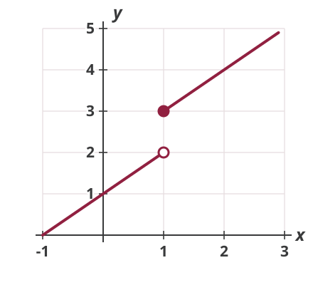
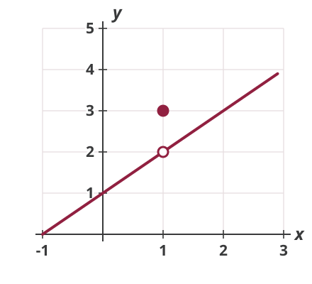

## What's on the exam

-   Wednesday, October 21, in class. 60 minutes, 20 points.

-   Module III: Calculus (Lectures 8--12; integration is not covered)

-   A sample exam with solutions and the help sheet provided with the exam are on the Exams page

-   Closed book: no phones or computers

-   For your review: lecture slides and worksheets, Practice Problems 8--12 (also collected as one PDF for the module), the module notes, and additional problems in the textbook

# Limits and the Derivative

## The Derivative

Average rate of change, then let the change shrink:
$$\frac{d y}{d x} = f'(x)= \lim_{\Delta x \rightarrow 0} \frac{f\left(x+\Delta x\right)-f\left(x\right)}{\Delta x}$$

Use the limit definition to find $f'(x)$ for $y = f(x) = x^2 + 3x$.

## Limits and Continuity

$\lim_{x \rightarrow a} f(x)$ exists only if the left-side and right-side limits agree; $f$ is *continuous* at $a$ if the limit exists and equals $f(a)$.

::: {.columns}
::: {.column width="50%"}
{.nostretch fig-alt="A line of slope 1 rising to an open circle at the point (1, 2), then jumping up to a filled dot at (1, 3) and continuing with slope 1 from there" width=400}
:::
::: {.column width="50%"}
{.nostretch fig-alt="A line of slope 1 with a hole, an open circle, at the point (1, 2), and an isolated filled dot above the hole at (1, 3); the line continues past the hole with the same slope" width=400}
:::
:::

## Continuity and Differentiability

Continuity is *necessary* for differentiability, but not *sufficient*.

$$g(x) = \begin{cases} 2x & \text{if } x < 1 \\ x + 1 & \text{if } x \geq 1 \end{cases}$$

Plot $g$. Is it continuous at $x = 1$? Is it differentiable there?

# Rules of Differentiation

## The Rules

Product, Quotient, and Chain Rule:

$$\frac{d}{d x}[f g]=f g' + f' g \qquad \frac{d}{d x} \frac{f}{g}=\frac{f' g-f g'}{g^2} \qquad \frac{d z}{d x}=\frac{d z}{d y} \cdot \frac{d y}{d x}$$

Find $dy/dx$:

-   $y = (x^2 + 1)(3x - 2)$

-   $y = \dfrac{x}{x + 2}$

-   $y = (2x + 1)^3$

## Exponential and Log Functions

$$\frac{d}{dx} e^{x} = e^{x} \qquad\qquad \frac{d}{dx} \ln x = \frac{1}{x}$$

For $e^{f(x)}$ and $\ln f(x)$, combine these with the chain rule. Find $dy/dx$:

-   $y = 3e^{2x}$

-   $y = x^2 \ln x$

-   $y = \ln(x^2 + 4)$

## Elasticity and Logs

$$\varepsilon = \frac{dy}{dx} \cdot \frac{x}{y} = \frac{d \ln y}{d \ln x}$$

Demand is $Q = \dfrac{50}{p^{2}}$. What is the price elasticity of demand? Is demand elastic or inelastic?

# Functions of Several Variables

## Partial Derivatives

Differentiate with respect to one variable, holding the others constant.

For $f(x, y) = x^2 y + y^3$, find $f_x$, $f_y$, and the gradient $\nabla f$. Is $f_x$ increasing in $y$?

## Production Function

$$Q = K^{0.3} L^{0.7}$$

Find the marginal product of capital $Q_K$ and of labor $Q_L$.

Is the marginal product of labor decreasing in $L$?

## Total Differential and Total Derivative

For $y = f(x_1, x_2, \ldots, x_n)$, the *total differential* is
$$dy = f_1 \cdot dx_1 + f_2 \cdot dx_2 + \cdots + f_n \cdot dx_n$$

If the other variables depend on $x_1$, the *total derivative* with respect to $x_1$ is
$$\frac{dy}{dx_1} = f_1 + f_2 \cdot \frac{dx_2}{dx_1} + \cdots + f_n \cdot \frac{dx_n}{dx_1}$$

## Example

$$z = x^2 + xy, \quad \text{where } x = t \text{ and } y = t^2$$

Find the total differential $dz$ and the total derivative $dz/dt$.

# Implicit Functions

## Implicit-Function Rule

For $F(x, y) = 0$, totally differentiate: $F_x \cdot dx + F_y \cdot dy = 0$, so
$$\frac{dy}{dx} = -\frac{F_x}{F_y}$$

## Market Equilibrium

Demand: $Q^d = Y - P^2$, with $Y$ income

Supply: $Q^s = P + \ln P$

The equilibrium condition cannot be solved for $P$ explicitly. Write it as $F(P, Y) = 0$ and find $\partial P / \partial Y$. Does higher income raise the price?
