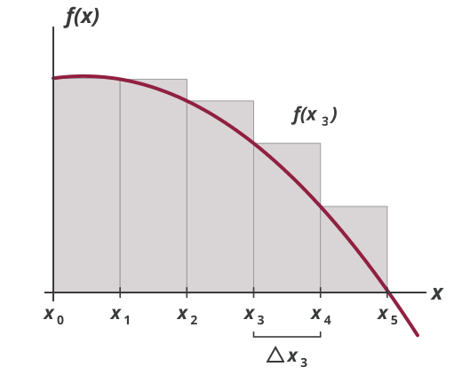
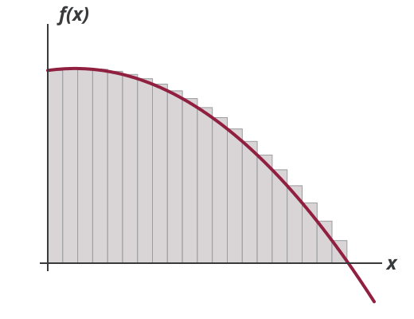

## Inverse of Differentiation

Path of population over time:
$$P(t) = 2 t^{0.5}$$

Rate of change of population:
$$P'(t)= \frac{d P}{dt} = t^{-0.5}$$

But what if instead we were given $P'(t)$ and were tasked with finding $P(t)$?

## Inverse of Differentiation

Note that
$$P'(t)= \frac{d P}{dt} = t^{-0.5}$$
is the derivative of $P(t) = 2 t^{0.5}$, but also of $P(t) = 2 t^{0.5} + 30$.

Generally, at best, we can find the following from just $P'(t)$:
$$P(t) = 2 t^{0.5} + c$$

However, if we have an initial condition such as $P(0) = 50$, we can also find $c$.

## Integration

-   Integration is the reverse of differentiation

-   If $f(x)$ is the derivative of $F(x)$, we can *integrate* $f(x)$ to find $F(x)$:
    $$\frac{d}{d x} F(x)=f(x) \; \Rightarrow \; \int f(x)\, d x=F(x)+c$$

-   Rules of integration follow from rules of differentiation

## Rules of Integration

*Power rule*
$$\int x^n\, d x=\frac{1}{n+1} \cdot x^{n +1} + c \quad (n \neq-1)$$

Examples:
$$\int x^3\, d x, \qquad \int x\, d x, \qquad \int 1\, d x$$

## Rules of Integration

*Exponential rule*
$$\int e^x\, d x=e^x+c$$

*Log rule*
$$\int \frac{1}{x}\, d x=\ln x+c \quad (x>0)$$

## Rules of Integration

*Integral of a sum*
$$\int[f(x)+g(x)]\, d x=\int f(x)\, d x+\int g(x)\, d x$$

*Integral of a multiple*
$$\int k f(x)\, d x=k \int f(x)\, d x$$

Example:
$$\int (x^2 + 3x + 1)\, dx = \hspace{7em}$$

## Definite Integrals

Definite integral:
$$\int_a^b f(x)\, d x=\Big[F(x)\Big]_{a}^b=F(b)-F(a)$$

Example:
$$\int_1^3 2 x^2\, dx = \hspace{7em}$$

## Area Under the Curve

::: {.columns}
::: {.column width="60%"}
{.nostretch fig-alt="A concave curve f of x over the interval from x zero to x five, with five grey rectangles of equal width standing under it, each as tall as the curve at its left edge; the fourth rectangle's width is marked delta x three and its height f of x three" width=520}
:::
::: {.column width="40%"}
$$\text{Area} \approx \sum_{i=1}^n f(x_i)\, \Delta x_i$$
:::
:::

## Area Under the Curve

::: {.columns}
::: {.column width="60%"}
{.nostretch fig-alt="The same concave curve with twenty narrow grey rectangles under it, which together fill the region under the curve almost exactly" width=520}
:::
::: {.column width="40%"}
$$\begin{aligned}
\text{Area} &= \lim_{n \rightarrow \infty} \sum_{i=1}^n f(x_i)\, \Delta x_i \\
&= \int_{x_1}^{x_n} f(x)\, dx
\end{aligned}$$
:::
:::

## Homework Questions

-   Exercise 14.2: 1 (a), (c), (d)

-   Exercise 14.3: 1 (a), (e), 2 (a), (d), 5

Textbook reference: 14.1-14.3

Midterm 2 is next week: review on Monday, exam on Wednesday

A sample exam and a help sheet are posted on the Exams page
