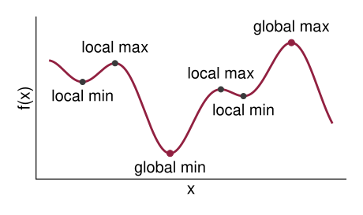
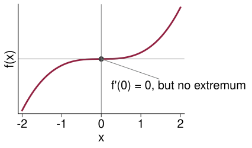
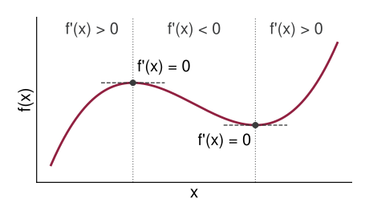
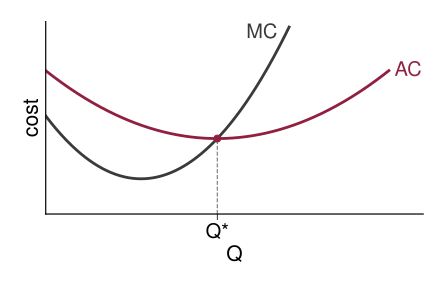

## Optimization

How many hours to work each week?

Utility from consumption ($C$) and leisure ($L$):
$$U(C, L)$$

Leisure is the difference between total hours ($T$) and hours worked ($H$):
$$L = T - H$$

Constraint:
$$wH = pC$$
where $w$ and $p$ denote the wage and the price, respectively.

## Optimization in Economics

-   Consumers choose consumption to *maximize* utility

-   Firms choose output to *maximize* profit, or inputs to *minimize* cost

-   Governments choose policy to maximize welfare, and so on

Today: the choice variable is a single number $x$ and there are no constraints.
$$\max_x \; f(x) \qquad \text{or} \qquad \min_x \; f(x)$$

## Global vs Local Extrema

{.nostretch fig-alt="A wavy curve f of x with several peaks and troughs. The highest peak is marked global max and the lowest trough global min; the other peaks are marked local max and the other troughs local min" width=760}

## Critical Points

We limit ourselves to functions that are *continuously differentiable*: $f$ is continuous and has a continuous derivative.
$$y = f(x)$$

A *necessary* condition for $x_0$ to be an interior extremum:
$$f'(x_0) = 0$$

$x_0$ is called a *critical* (or *stationary*) point.

::: {.fragment}
Why is this not sufficient?
:::

## Inflection Point

{.nostretch fig-alt="The S-shaped curve y equals x cubed, rising through the origin where it flattens out momentarily. A dot marks the origin with the note f prime of 0 equals 0 but no extremum" width=760}

## First-Derivative Test

Suppose that $f'(x_0) = 0$. Then $f(x_0)$ is a

1.  *maximum* if $f'(x)$ goes from $+$ to $-$ in the immediate neighborhood of $x_0$

2.  *minimum* if $f'(x)$ goes from $-$ to $+$ in the immediate neighborhood of $x_0$

3.  *not an extremum* if $f'(x)$ has the same sign on both sides of $x_0$

## First-Derivative Test

{.nostretch fig-alt="A curve that rises, peaks where a dashed horizontal tangent is drawn and labeled f prime of x equals 0, falls to a trough with another dashed horizontal tangent labeled the same way, then rises again. The rising stretches are labeled f prime of x greater than 0 and the falling stretch f prime of x less than 0" width=880}

## Example

Find the critical points of
$$f(x) = x^2 - 24x + 36$$
and determine whether each one is a maximum or a minimum.

## Example

Find the critical points of
$$f(x) = 2x^3 - 9x^2 + 12x$$
and determine whether each one is a maximum or a minimum.

## Example: Average and Marginal Cost

Total cost: $TC = C(Q)$

Marginal cost: $MC = C'(Q)$

Average cost:
$$AC = \frac{C(Q)}{Q}$$

At what quantity is $AC$ the lowest?

## Average and Marginal Cost

{.nostretch fig-alt="A clearly U-shaped average cost curve AC in maroon that falls steeply, bottoms out, and rises again, and a marginal cost curve MC in grey that dips and then rises steeply, crossing AC exactly at AC's lowest point. A dot and a dashed vertical line mark that point at the quantity Q star" width=700}

## Example: Profit Maximization

A firm's profit is revenue minus cost:
$$\pi(Q) = R(Q) - C(Q)$$

What condition must hold at the profit-maximizing output $Q^*$?

::: {.fragment}
Does every $Q$ that satisfies this condition maximize profit?
:::

## Homework Questions

-   Exercise 9.2: 1 (c), 2 (a), 3, 4

Textbook reference: 9.1, 9.2
