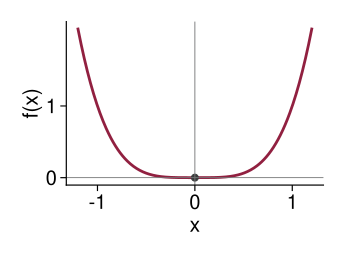

## Recap

For a continuously differentiable function $y = f(x)$:

-   A critical point $x_0$ satisfies $f'(x_0) = 0$ (necessary for an interior extremum)

-   First-derivative test: check whether $f'(x)$ changes sign at $x_0$

Today: a quicker test that uses the *second derivative*.

## Second and Higher Derivatives

The derivative of $f'(x)$ is called the *second derivative*:
$$f''(x) = \frac{d^2 y}{dx^2}$$

Similarly, we can obtain higher-order derivatives:
$$f'''(x),\; f^{(4)}(x),\; \ldots,\; f^{(n)}(x) \qquad \text{or} \qquad \frac{d^3 y}{dx^3},\; \frac{d^4 y}{dx^4},\; \ldots,\; \frac{d^n y}{dx^n}$$

Example: find $f''(x)$ for $f(x) = 2x^3 - 9x^2 + 12x$

## What the Second Derivative Tells Us

With an infinitesimal increase in $x$ from $x_0$:

-   The *value* of the function increases if $f'(x_0) > 0$ and decreases if $f'(x_0) < 0$

-   The *slope* of the function increases if $f''(x_0) > 0$ and decreases if $f''(x_0) < 0$

## Second-Derivative Test

If $f'(x_0) = 0$, then $f(x_0)$ is

1.  a *maximum* if $f''(x_0) < 0$

2.  a *minimum* if $f''(x_0) > 0$

More convenient to use than the first-derivative test.

::: {.fragment}
What if $f''(x_0) = 0$?
:::

## Example

Recall from Monday:
$$f(x) = 2x^3 - 9x^2 + 12x$$
Classify its critical points using the second-derivative test.

## Example

$$f(x) = x^4 - 4x^3$$

Find the critical points. What does the second-derivative test say at each one?

## Necessary vs Sufficient Conditions

For a *maximum* at $x_0$:

-   First-order necessary: $f'(x_0) = 0$

-   Second-order necessary: $f''(x_0) \leq 0$

-   Second-order sufficient: $f''(x_0) < 0$

For a *minimum*, reverse the inequalities. The second-order conditions apply only after the first-order condition is satisfied.

## $y = x^4$

{.nostretch fig-alt="The graph of y equals x to the fourth power: a flat-bottomed U shape with its minimum at the origin, where a dot is drawn" width=560}

## Homework Questions

-   Exercise 9.4: 1 (b), (d), 2, 3

Textbook reference: 9.4
