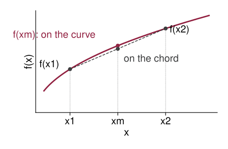
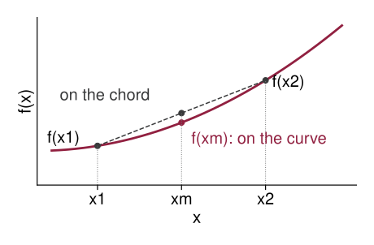
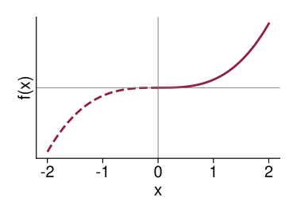

## Concave and Convex Functions

-   *Concave* function: $f''(x) \leq 0$ for all $x$

-   *Convex* function: $f''(x) \geq 0$ for all $x$

-   *Strictly concave* function: $f''(x) < 0$ for all $x$

-   *Strictly convex* function: $f''(x) > 0$ for all $x$

## Concave and Convex Functions

$f$ is *concave* if, for any $x_1$, $x_2$ and $\lambda \in (0, 1)$,
$$f(\lambda x_1 + (1 - \lambda) x_2) \geq \lambda f(x_1) + (1 - \lambda) f(x_2)$$

$f$ is *convex* if
$$f(\lambda x_1 + (1 - \lambda) x_2) \leq \lambda f(x_1) + (1 - \lambda) f(x_2)$$

For strict concavity or convexity, replace with strict inequalities.

## Concave Function

{.nostretch fig-alt="A concave curve rising and flattening, with two points on it at x one and x two joined by a dashed chord. At the midpoint x m between them, the point on the curve, labeled f of x m, sits above the point on the chord" width=600}

At $x_m = \lambda x_1 + (1 - \lambda) x_2$, the curve lies *above* the chord: $f(x_m) \geq \lambda f(x_1) + (1 - \lambda) f(x_2)$

## Convex Function

{.nostretch fig-alt="A convex curve rising ever more steeply, with two points on it at x one and x two joined by a dashed chord. At the midpoint x m between them, the point on the curve, labeled f of x m, sits below the point on the chord" width=600}

At $x_m = \lambda x_1 + (1 - \lambda) x_2$, the curve lies *below* the chord: $f(x_m) \leq \lambda f(x_1) + (1 - \lambda) f(x_2)$

## Attitudes toward Risk

Consider the following game: flip a coin, collect \$0 if tails, collect \$20 if heads.

How much would you pay to play this game?

::: {.fragment}
If your utility from money $u(m)$ is concave, how does $u(10)$ compare with $\tfrac{1}{2} u(0) + \tfrac{1}{2} u(20)$?
:::

## Example

The domain of $f$ is all real numbers:
$$f(x) = x^3$$

Is $f$ convex, strictly convex, concave, or strictly concave?

What if the domain of $f$ is all nonnegative real numbers?

## $f(x) = x^3$

{.nostretch fig-alt="The graph of y equals x cubed, drawn solid for x at least 0 where it bends upward, and dashed for negative x where it bends downward, passing through the origin" width=600}

## Properties of Concave and Convex Functions

1.  A linear function is both concave and convex, but not strictly so.

2.  If $f(x)$ is (strictly) concave, then $-f(x)$ is (strictly) convex, and vice versa.

3.  If $f(x)$ and $g(x)$ are both concave (convex), then $f(x) + g(x)$ is concave (convex). If, in addition, one or both of them are strictly concave (convex), then $f(x) + g(x)$ is strictly concave (convex).

## Global Optimizers

-   If a function is concave, any critical point gives a global maximum.

-   If a function is strictly concave, any critical point gives the *unique* global maximum.

-   If a function is convex, any critical point gives a global minimum.

-   If a function is strictly convex, any critical point gives the *unique* global minimum.

## Example

Say $f(x)$ is a strictly concave function and
$$f'(2) = 0$$

Is $f(2)$ a local or a global maximum? Is it the unique maximum?

## Example: Profit Maximization

A firm's profit is $\pi(Q) = R(Q) - C(Q)$ with revenue $R(Q) = 20Q - Q^2$ and cost $C(Q) = 4Q + 10$.

Find the profit-maximizing output. Is it a global maximum? Why?

## Homework Questions

-   Exercise 9.3: 2, 3, 4, 5

-   Exercise 9.4: 5

Textbook reference: 9.3
