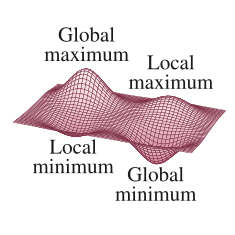
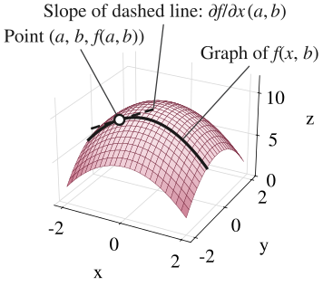
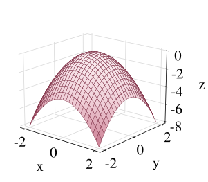
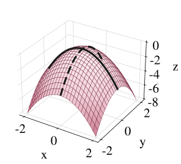
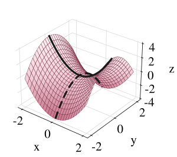
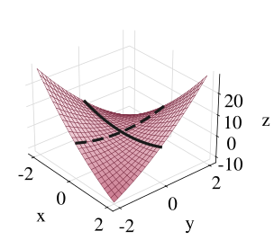

## More than One Choice Variable

$$z = f(x, y)$$

What pair of values for $x$ and $y$ maximizes or minimizes this function?

We continue to restrict ourselves to continuous functions with continuous first derivatives.

## More than One Choice Variable

{.nostretch fig-alt="A three-dimensional surface over the x y plane with four labeled features: a tall peak labeled global maximum, a lower peak labeled local maximum, a shallow pit labeled local minimum, and a deep pit labeled global minimum" width=590}

## First-Order Conditions

For the function
$$z = f(x, y)$$

The first-order (necessary) condition:
$$f_x = f_y = 0$$

## Partial Derivative

{.nostretch fig-alt="A dome-shaped surface z equals f of x, y. A solid curve on the surface shows the graph of f of x, b, holding y fixed at b. A dashed line touches this curve at the marked point a, b, f of a, b. The slope of the dashed line is the partial derivative of f with respect to x at a, b" width=560}

## Example

What are the critical points of
$$f(x, y) = -(x^2 + y^2)$$

## $f(x, y) = -(x^2 + y^2)$

{.nostretch fig-alt="A dome-shaped surface over the x y plane with its single highest point at the origin, where z equals 0" width=600}

## Example

What are the critical points of
$$\pi(K, L) = f(K, L) - rK - wL$$

## OLS

$$\min_{\alpha, \beta} \quad f(\alpha, \beta) = \sum_{i=1}^n (Y_i - \alpha - \beta X_i)^2$$

First-order conditions:
$$\begin{aligned}
\frac{\partial f}{\partial \alpha} &= -2 \sum_{i=1}^n (Y_i - \alpha - \beta X_i) = 0 \\[0.8em]
\frac{\partial f}{\partial \beta} &= -2 \sum_{i=1}^n (Y_i - \alpha - \beta X_i) X_i = 0
\end{aligned}$$

## Second-Order Partial Derivatives

For the function
$$z = f(x, y)$$

$$\begin{aligned}
f_{xx} &\equiv \frac{\partial}{\partial x} f_x \quad \text{or} \quad \frac{\partial^2 z}{\partial x^2} \equiv \frac{\partial}{\partial x}\left(\frac{\partial z}{\partial x}\right) \\[1em]
f_{yy} &\equiv \frac{\partial}{\partial y} f_y \quad \text{or} \quad \frac{\partial^2 z}{\partial y^2} \equiv \frac{\partial}{\partial y}\left(\frac{\partial z}{\partial y}\right)
\end{aligned}$$

## Second-Order Partial Derivatives

We also have cross (or mixed) second-order partial derivatives:
$$\begin{aligned}
f_{xy} &\equiv \frac{\partial^2 z}{\partial x \partial y} \equiv \frac{\partial}{\partial x}\left(\frac{\partial z}{\partial y}\right) \\[1em]
f_{yx} &\equiv \frac{\partial^2 z}{\partial y \partial x} \equiv \frac{\partial}{\partial y}\left(\frac{\partial z}{\partial x}\right)
\end{aligned}$$

We always have $f_{xy} = f_{yx}$ as long as $f_{xy}$ and $f_{yx}$ are both continuous.

## Example

Find the four second-order partial derivatives of
$$z = x^3 + 5xy - y^2$$

## Second-Order Conditions

At a critical point, the second-order (sufficient) conditions are:

-   Maximum: $f_{xx} < 0$, $f_{yy} < 0$, and $f_{xx} f_{yy} > (f_{xy})^2$

-   Minimum: $f_{xx} > 0$, $f_{yy} > 0$, and $f_{xx} f_{yy} > (f_{xy})^2$

If $f_{xx} f_{yy} < (f_{xy})^2$, the point is a *saddle point*: neither a maximum nor a minimum.

## Example

Find the critical point of each function and determine whether it is a maximum, a minimum, or neither.

1.  $f(x, y) = -(x^2 + y^2)$

2.  $f(x, y) = x^2 - y^2$

3.  $f(x, y) = x^2 + y^2 + 5xy$

## $f(x, y) = -(x^2 + y^2)$

{.nostretch fig-alt="A dome-shaped surface with its highest point at the origin. A solid curve along the x direction and a dashed curve along the y direction both bend downward and meet at the top, so the origin is a maximum" width=600}

## $f(x, y) = x^2 - y^2$

{.nostretch fig-alt="A saddle-shaped surface. Through the origin, a solid curve along the x direction bends upward while a dashed curve along the y direction bends downward, so the origin is a saddle point" width=600}

## $f(x, y) = x^2 + y^2 + 5xy$

{.nostretch fig-alt="A saddle-shaped surface twisted relative to the axes. Through the origin, the solid curve along the x direction and the dashed curve along the y direction both bend upward, yet the surface falls away along the diagonal where x equals negative y, so the origin is a saddle point and not a minimum" width=600}

## Hessian Matrix

For the function
$$y = f(x_1, x_2, \ldots, x_n)$$

The gradient vector $\nabla f$ and Hessian matrix $H$ are
$$\nabla f = \begin{bmatrix} f_1 \\ f_2 \\ \vdots \\ f_n \end{bmatrix} \qquad H = \begin{bmatrix} f_{11} & f_{12} & \cdots & f_{1n} \\ f_{21} & f_{22} & \cdots & f_{2n} \\ \vdots & \vdots & & \vdots \\ f_{n1} & f_{n2} & \cdots & f_{nn} \end{bmatrix}$$

## More than Two Choice Variables

-   First-order necessary, for a maximum or a minimum: $f_1 = f_2 = \cdots = f_n = 0$, that is, $\nabla f = 0$

-   Second-order sufficient for a maximum: $\lvert H_1 \rvert < 0$, $\lvert H_2 \rvert > 0$, $\lvert H_3 \rvert < 0$, $\ldots$

-   Second-order sufficient for a minimum: $\lvert H_1 \rvert, \lvert H_2 \rvert, \ldots, \lvert H_n \rvert > 0$

Here $\lvert H_k \rvert$ is the determinant of the upper-left $k \times k$ block of $H$. The second-order conditions apply only after the first-order condition is satisfied.

## Homework Questions

-   Exercise 11.2: 1, 2, 3, 4, 5

Textbook reference: 11.1, 11.2
