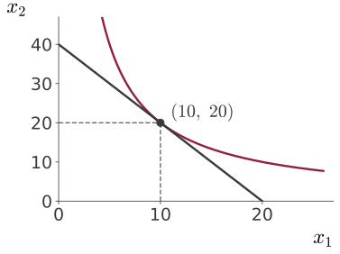

## Utility Maximization

Maximize:
$$f(x_1, x_2) = x_1 x_2$$

Subject to the budget constraint:
$$2x_1 + x_2 = 40$$

To find $x_1^*$ and $x_2^*$, we could substitute $x_2 = 40 - 2x_1$ and use our first-order and second-order conditions.

## Utility Maximization

$$f(x_1, x_2) = x_1 (40 - 2x_1) = 40x_1 - 2x_1^2$$

## Constrained Maximization

Substitution doesn't always work, and it gets complicated with many variables and constraints.

Thankfully, we have the method of Lagrange multipliers.

Lagrange function:
$$L(x_1, x_2, \lambda) = x_1 x_2 + \lambda(40 - 2x_1 - x_2)$$

$\lambda$ is the Lagrange multiplier.

Now apply the first-order conditions for the case of three variables ($x_1$, $x_2$, $\lambda$).

## Utility Maximization

$$L(x_1, x_2, \lambda) = x_1 x_2 + \lambda(40 - 2x_1 - x_2)$$

First-order conditions:
$$\begin{aligned}
\frac{\partial L}{\partial x_1} &= x_2 - 2\lambda = 0 \\[0.6em]
\frac{\partial L}{\partial x_2} &= x_1 - \lambda = 0 \\[0.6em]
\frac{\partial L}{\partial \lambda} &= 40 - 2x_1 - x_2 = 0
\end{aligned}$$

## Lagrange-Multiplier Method

Given an objective function
$$y = f(x_1, x_2)$$

subject to the constraint
$$g(x_1, x_2) = c$$

where $c$ is a constant. We can write the Lagrange function as
$$L(x_1, x_2, \lambda) = f(x_1, x_2) + \lambda[c - g(x_1, x_2)]$$

## Lagrange-Multiplier Method

$$L(x_1, x_2, \lambda) = f(x_1, x_2) + \lambda[c - g(x_1, x_2)]$$

First-order conditions:
$$\begin{aligned}
\frac{\partial L}{\partial x_1} &= f_1(x_1^*, x_2^*) - \lambda^* g_1(x_1^*, x_2^*) = 0 \\[0.6em]
\frac{\partial L}{\partial x_2} &= f_2(x_1^*, x_2^*) - \lambda^* g_2(x_1^*, x_2^*) = 0 \\[0.6em]
\frac{\partial L}{\partial \lambda} &= c - g(x_1^*, x_2^*) = 0
\end{aligned}$$

## Utility Maximization

:::: {.columns}
::: {.column width="58%"}
{.nostretch fig-alt="Axes x1 across and x2 up. A straight downward-sloping line runs from 40 on the x2 axis to 20 on the x1 axis. A bowed-in curve touches the line at exactly one point, (10, 20), marked with a dot and dashed guide lines to both axes" width=560}
:::
::: {.column width="42%"}
At the optimal point:
$$\frac{\partial f / \partial x_1}{\partial f / \partial x_2} = \frac{\partial g / \partial x_1}{\partial g / \partial x_2}$$

Balance the trade-off: optimize $f$ versus satisfy $g$
:::
::::

## Interpretation of the Lagrange Multiplier

At the optimum:
$$L(x_1^*, x_2^*, \lambda^*) = f(x_1^*, x_2^*) + \lambda^*[c - g(x_1^*, x_2^*)]$$

What if $c$ changes by a little bit?

$$\begin{aligned}
\frac{dL^*}{dc} &= f_1 \frac{dx_1^*}{dc} + f_2 \frac{dx_2^*}{dc} + \lambda^*\left[1 - g_1 \frac{dx_1^*}{dc} - g_2 \frac{dx_2^*}{dc}\right] \\[0.6em]
&= \underbrace{(f_1 - \lambda^* g_1)}_{0} \frac{dx_1^*}{dc} + \underbrace{(f_2 - \lambda^* g_2)}_{0} \frac{dx_2^*}{dc} + \lambda^* = \lambda^*
\end{aligned}$$

## Utility Maximization

$$L(x_1, x_2, \lambda) = x_1 x_2 + \lambda(40 - 2x_1 - x_2)$$

At the optimum:
$$x_2^* = 2x_1^*, \quad 2x_1^* + x_2^* = 40 \quad \rightarrow \quad x_1^* = 10, \ x_2^* = 20, \ \lambda^* = 10$$

If my income increases by \$1, by how much does my utility increase? $\lambda^* = 10$
