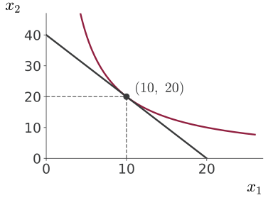
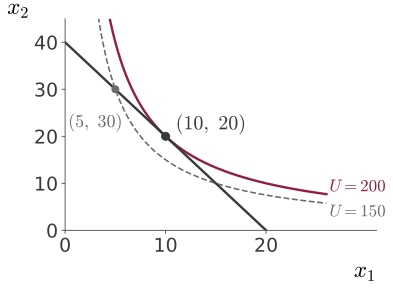

## Utility Maximization

$$\max_{\{x_1, x_2\}} \quad x_1 x_2 \quad \text{s.t.} \quad 2x_1 + x_2 = 40$$

Lagrange function:
$$L(x_1, x_2, \lambda) = x_1 x_2 + \lambda(40 - 2x_1 - x_2)$$

First-order conditions:
$$x_2 - 2\lambda = 0, \qquad x_1 - \lambda = 0, \qquad 40 - 2x_1 - x_2 = 0$$

From the first two, $x_2 = 2x_1$. Then $2x_1 + 2x_1 = 40$:
$$x_1^* = 10, \qquad x_2^* = 20, \qquad \lambda^* = 10$$

## The Solution on the Graph

:::: {.columns}
::: {.column width="55%"}
{.nostretch fig-alt="Axes x1 across and x2 up. A straight downward-sloping line runs from 40 on the x2 axis to 20 on the x1 axis. A bowed-in curve touches the line at exactly one point, (10, 20), marked with a dot and dashed guide lines to both axes" width=520}
:::
::: {.column width="45%"}
Slope of the indifference curve:
$$-\frac{f_1}{f_2} = -\frac{x_2}{x_1}$$

Slope of the budget line:
$$-\frac{p_1}{p_2} = -2$$

At $(10, 20)$ both equal $-2$: the curves are *tangent*.
:::
::::

## Why Is $(10, 20)$ the Best?

:::: {.columns}
::: {.column width="56%"}
{.nostretch fig-alt="Axes x1 across and x2 up. A straight budget line 2 x1 plus x2 equals 40 runs from 40 on the x2 axis to 20 on the x1 axis. A bold bowed-in indifference curve labeled U equals 200 touches the budget line at exactly one point, (10, 20). A dashed, lower indifference curve labeled U equals 150 crosses the budget line at the point (5, 30) and again further right" width=560}
:::
::: {.column width="44%"}
Both points cost \$40.

Utility per dollar, $f_1/p_1$ vs. $f_2/p_2$:
$$\begin{aligned}
(5, 30)&: \quad 15 \ \text{vs.}\ 5 \\
(10, 20)&: \quad 10 \ \text{vs.}\ 10
\end{aligned}$$

At $(5, 30)$, moving \$1 to good 1 gains 15 and loses 5.

At $(10, 20)$, no move helps.
:::
::::

## What the Lagrange Conditions Say

At the optimum, utility per dollar is the same for both goods:
$$\frac{f_1}{p_1} = \frac{f_2}{p_2} = \lambda \qquad \Longleftrightarrow \qquad \frac{f_1}{f_2} = \frac{p_1}{p_2} \quad \text{(tangency)}$$

That is exactly what the first-order conditions of $L$ say:
$$f_1 = \lambda p_1, \qquad f_2 = \lambda p_2, \qquad 2x_1 + x_2 = 40$$

$\lambda^* = 10$ is that common utility per dollar: the extra utility from one more dollar of income.

## Lagrange-Multiplier Method

In general, to maximize $f(x_1, x_2)$ subject to $g(x_1, x_2) = c$:

$$L(x_1, x_2, \lambda) = f(x_1, x_2) + \lambda[c - g(x_1, x_2)]$$

First-order conditions:
$$\begin{aligned}
\frac{\partial L}{\partial x_1} &= f_1(x_1^*, x_2^*) - \lambda^* g_1(x_1^*, x_2^*) = 0 \\[0.6em]
\frac{\partial L}{\partial x_2} &= f_2(x_1^*, x_2^*) - \lambda^* g_2(x_1^*, x_2^*) = 0 \\[0.6em]
\frac{\partial L}{\partial \lambda} &= c - g(x_1^*, x_2^*) = 0
\end{aligned}$$

## Interpretation of the Lagrange Multiplier

At the optimum:
$$L(x_1^*, x_2^*, \lambda^*) = f(x_1^*, x_2^*) + \lambda^*[c - g(x_1^*, x_2^*)]$$

What if $c$ changes by a little bit?

$$\begin{aligned}
\frac{dL^*}{dc} &= f_1 \frac{dx_1^*}{dc} + f_2 \frac{dx_2^*}{dc} + \lambda^*\left[1 - g_1 \frac{dx_1^*}{dc} - g_2 \frac{dx_2^*}{dc}\right] \\[0.6em]
&= \underbrace{(f_1 - \lambda^* g_1)}_{0} \frac{dx_1^*}{dc} + \underbrace{(f_2 - \lambda^* g_2)}_{0} \frac{dx_2^*}{dc} + \lambda^* = \lambda^*
\end{aligned}$$

## Back to the Example

$\lambda^* = 10$: one more dollar of income should raise utility by about 10.

Check: with \$41 instead of \$40,
$$x_1^* = 10.25, \qquad x_2^* = 20.5, \qquad f = 210.1 \approx 200 + 10$$

## Example III

$$\max_{\{x_1, x_2\}} \quad x_1^{1/3} x_2^{2/3} \quad \text{s.t.} \quad x_1 + 4x_2 = 30$$

## More Generally

$$\max_{\{x_1, x_2\}} \quad x_1^{\alpha} x_2^{\beta} \quad \text{s.t.} \quad p_1 x_1 + p_2 x_2 = m$$

## Multiple Variables

Objective function:
$$\text{Maximize } f(x_1, x_2, \ldots, x_n) \quad \text{subject to} \quad g(x_1, x_2, \ldots, x_n) = c$$

Lagrange function:
$$L = f(x_1, x_2, \ldots, x_n) + \lambda[c - g(x_1, x_2, \ldots, x_n)]$$

First-order conditions:
$$\begin{aligned}
L_i &= f_i(x_1, x_2, \ldots, x_n) - \lambda g_i(x_1, x_2, \ldots, x_n) = 0 \qquad [i = 1, 2, \ldots, n] \\[0.4em]
L_\lambda &= c - g(x_1, x_2, \ldots, x_n) = 0
\end{aligned}$$

## Multiple Constraints

Maximize $f(x_1, x_2, \ldots, x_n)$ subject to
$$g(x_1, x_2, \ldots, x_n) = c \quad \text{and} \quad h(x_1, x_2, \ldots, x_n) = d$$

Lagrange function:
$$L = f(x_1, \ldots, x_n) + \lambda[c - g(x_1, \ldots, x_n)] + \mu[d - h(x_1, \ldots, x_n)]$$

First-order conditions:
$$\begin{aligned}
L_\lambda &= c - g(x_1, \ldots, x_n) = 0 \\[0.3em]
L_\mu &= d - h(x_1, \ldots, x_n) = 0 \\[0.3em]
L_i &= f_i - \lambda g_i - \mu h_i = 0 \qquad [i = 1, 2, \ldots, n]
\end{aligned}$$

## Example IV

$$\max_{\{x, y, z\}} \quad yz + xz \quad \text{s.t.} \quad y^2 + z^2 = 1 \quad \text{and} \quad xz = 3$$

## Intertemporal Utility Maximization

$$U = U(c_1, c_2) = \ln c_1 + \beta \ln c_2 \qquad 0 < \beta < 1$$

-   $y_1, y_2 > 0$: income in periods 1 and 2

-   Income you save, $s$, in period 1 earns interest $r > 0$

-   In which case,
    $$c_1 + s = y_1 \qquad c_2 = y_2 + (1 + r)s$$

-   Combining these constraints:
    $$c_1 + \frac{1}{1+r} c_2 = \underbrace{y_1 + \frac{1}{1+r} y_2}_{m \,\equiv\, \text{present-discounted income}}$$

## Intertemporal Utility Maximization

$$\max_{\{c_1, c_2\}} \quad U(c_1, c_2) = \ln c_1 + \beta \ln c_2 \quad \text{s.t.} \quad c_1 + \frac{1}{1+r} c_2 = m$$

## Another Example: Lasso Regression

-   Regularization is a fundamental concept in machine learning and statistics, used to improve how well models generalize to new data by preventing overfitting

-   Overfitting occurs when a model learns the detail and noise in the training data

-   Regularization techniques modify the learning algorithm to impose constraints on the model parameters, typically by adding a penalty term to the loss function

## Lasso Regression

Linear regression, unconstrained minimization:
$$L(\beta) = \sum_{i=1}^n (Y_i - X_i^T \beta)^2$$

Lasso regression, with a penalty on the size of the coefficients:
$$L(\beta) = \sum_{i=1}^n (Y_i - X_i^T \beta)^2 + \lambda \sum_{j=1}^p |\beta_j|$$

Higher values of $\lambda$ increase the penalty for large coefficients.

## Homework Questions

-   Exercise 12.2: 1, 2, 3, 4 (in Practice Problems 18)

-   Practice Problems 20: utility maximization, cost minimization, and intertemporal choice

Textbook reference: 12.2
